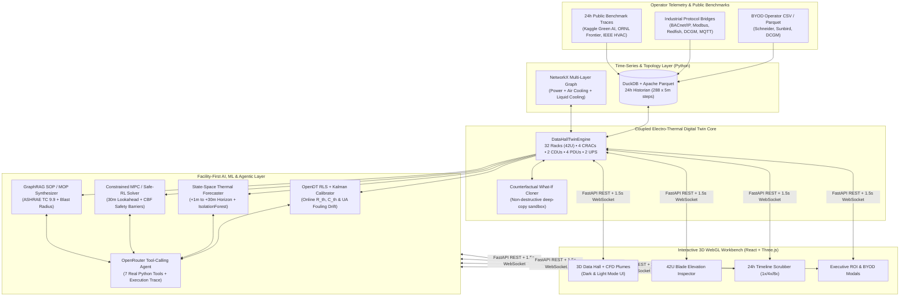

# Pandita's Aether-DCTWIN
**AI-Native Digital Twin & Autonomous Facility Operations Platform for High-Density AI Data Centers**

---

## Overview

**Pandita's Aether-DCTWIN** is a full-stack **Data Center Digital Twin** engineered for modern hybrid-cooled data halls that combine traditional perimeter air cooling (`CRAC`) with **direct-to-chip liquid cooling (`CDU`)** for high-density AI GPU clusters (`65–85 kW/rack`).

Designed around the real-world **Facility vs. IT organizational boundary**, Aether-DCTWIN delivers predictive thermal intelligence, online self-calibrating physics, constrained Model Predictive Control (`MPC`), automated Method of Procedure (`MOP`) generation, and counterfactual *"What-If"* capacity simulation **without ever requiring agents or access inside tenant servers**.

---

## Key Capabilities at a Glance

| Capability Pillar | What It Does | Key Modules |
| :--- | :--- | :--- |
| **1. 3D Spatial Digital Twin & 42U Elevation Inspector** | Interactive 3D WebGL data hall (`32 Racks`, `4 CRACs`, `2 Liquid CDUs`, `4 PDUs`, `2 UPS`) with 5 real-time heatmap layers, animated CFD exhaust plumes, liquid coolant flow pulses, **Light/Dark Mode**, and clickable **42U server blade drill-down**. | `frontend/src/components/DataHall3D.tsx`, `RackElevation42U.tsx` |
| **2. PUE Decomposition, TOU Grid Tariff & UPS BESS Peak-Shaving** | Real-time 5-way facility power & PUE decomposition, 24-hour Utility Time-of-Use (`TOU`) tariff arbitrage, **UPS-A/B Li-Ion BESS peak-demand shaving (`115–165 kW`)**, chilled-water thermal storage pre-cooling/coasting, and utility Demand Response (`DR`) simulation. | `backend/ai_engine.py`, `FacilityMLSuitePanel.tsx` |
| **3. OpenDT Online Self-Calibration (RLS + Kalman Filter)** | Continuously learns each cooling zone's **Thermal Resistance ($R_{\text{th}}$)** and **Thermal Capacitance ($C_{\text{th}}$)** from facility PDU & CDU/CRAC sensors—cutting temperature RMSE from `±3.00°C` to `±0.34°C` and detecting heat-exchanger `UA` fouling drift weeks before alarms fire. | `backend/ai_engine.py`, `FacilityMLSuitePanel.tsx` |
| **4. Constrained MPC / Safe-RL Cooling Controller** | Solves a 30-minute lookahead trajectory (`+0m` to `+30m`) with hard **Control Barrier Functions (CBF)** (`Cold-Aisle ≤ 27.0°C`, `CDU Return ≤ 40.0°C`, `Max VFD Slew ≤ 4%/min`), pre-cooling ahead of AI load surges and eliminating CRAC fan hunting. | `backend/ai_engine.py`, `FacilityMLSuitePanel.tsx` |
| **5. GraphRAG Blast-Radius & Automated MOP Generator** | Traverses the `NetworkX` facility topology graph from any asset (`CDU-1`, `CRAC-2`, `PDU-C`) to identify downstream racks and generates an ASHRAE TC 9.9 / vendor-compliant **Method of Procedure (MOP)** with `T-15m` pre-cooling setpoints and LOTO steps. | `backend/ai_engine.py`, `FacilityMLSuitePanel.tsx` |
| **6. Real OpenRouter LLM Tool-Calling Agent** | Live function-calling LLM loop (`OpenRouter` / `OpenAI` compatible) that autonomously chains 7 simulator, calibration, MPC, GraphRAG, and DuckDB SQL tools and displays full execution traces. | `backend/llm_agent.py`, `App.tsx` |
| **7. 24-Hour DuckDB + Parquet Replay & BYOD Connector Hub** | Embedded **DuckDB + Parquet** historian with 24-hour public benchmark traces (*Kaggle Green AI*, *ORNL Frontier CDU*, *IEEE DataPort HVAC*), drag-and-drop **BYOD CSV auto-mapper**, and live **BACnet/IP, Modbus, Redfish, NVIDIA DCGM, and MQTT** protocol bridges. | `backend/telemetry_store.py`, `backend/connectors.py`, `DataConnectorsModal.tsx` |
| **8. Executive ROI & Sustainability Report Generator** | One-click financial business case quantifying PUE reduction, annual `\$` and `MWh` savings, `tCO₂` and evaporative water avoided, and **unlocked AI GPU capacity (`+GPUs` & avoided Tier-III CapEx)** with Markdown export. | `ExecutiveROIModal.tsx`, `backend/ai_engine.py` |

---

## System Architecture



---

## Quick Start

### 1. Single-Command Local Launch
```bash
chmod +x start_twin.sh
./start_twin.sh
```
Open **http://127.0.0.1:8000** in your browser.

*(Optional)* To pre-configure your OpenRouter API key via environment variable (or you can paste it directly into the **Agent** tab in the UI):
```bash
export OPENROUTER_API_KEY="sk-or-v1-..."
./start_twin.sh
```

### 2. Docker Compose Launch
```bash
docker compose up --build
```

### 3. Hot-Reload Development Mode
```bash
# Terminal 1: FastAPI Backend
PYTHONPATH=backend .venv/bin/uvicorn main:app --reload --port 8000

# Terminal 2: Vite Frontend Dev Server
cd frontend && npm run dev
```

---

## Documentation Index

- **[README.md](file:///Users/pb/dctwin/README.md)** — Architecture overview, quick start, and repository map.
- **[docs/DEPLOYMENT.md](file:///Users/pb/dctwin/docs/DEPLOYMENT.md)** — Complete deployment guide: Local bare-metal, Docker & Docker Compose, Cloud PaaS (Render/Railway/Fly.io), Cloud VM + Systemd & Nginx TLS (`wss://`), On-Premises Kubernetes (`k8s`), and BMS/DCIM firewall rules.
- **[docs/TECHNICAL_DOCUMENTATION.md](file:///Users/pb/dctwin/docs/TECHNICAL_DOCUMENTATION.md)** — Deep dive into the coupled electro-thermal physics equations, OpenDT RLS/Kalman calibration math, Constrained MPC + Control Barrier Functions, NetworkX GraphRAG, DuckDB schema, OpenRouter tool-calling protocol, and full REST/WebSocket API reference.
- **[docs/USER_DOCUMENTATION.md](file:///Users/pb/dctwin/docs/USER_DOCUMENTATION.md)** — Complete operator & sales playbook covering the 3D viewport, 42U blade inspector, 24h time-series replay, BYOD customer CSV onboarding, MPC/MOP generation, OpenRouter Agent setup, and Executive ROI report export.

---

## Repository Structure

```text
/Users/pb/dctwin/
├── README.md                          # Project overview & quick start
├── start_twin.sh                      # One-command launcher script
├── Dockerfile                         # Multi-stage Node 22 + Python 3.12 container build
├── docker-compose.yml                 # Docker Compose deployment
├── data/                              # Persistent DuckDB database & Parquet time-series files
│   ├── dctwin_telemetry.duckdb
│   ├── kaggle_green_ai_24h.parquet
│   ├── ornl_frontier_cdu_24h.parquet
│   └── ieee_ashrae_fault_24h.parquet
├── docs/
│   ├── TECHNICAL_DOCUMENTATION.md     # Physics, ML algorithms, schemas & API reference
│   └── USER_DOCUMENTATION.md          # Operator guide & customer demo walkthrough
├── backend/
│   ├── requirements.txt               # Python dependencies (FastAPI, NumPy, SciPy, scikit-learn, NetworkX, DuckDB)
│   ├── models.py                      # Pydantic v2 data schemas across all layers
│   ├── simulator.py                   # Coupled electro-thermal & 42U physics engine + NetworkX topology
│   ├── ai_engine.py                   # Forecaster, IsolationForest, OpenDT RLS, MPC solver, GraphRAG MOP & ROI engine
│   ├── llm_agent.py                   # Live OpenRouter / OpenAI function-calling agent loop (7 callable tools)
│   ├── telemetry_store.py             # DuckDB + Parquet 24-hour historian & SQL analytics
│   ├── connectors.py                  # Enterprise BACnet/Modbus/Redfish/DCGM bridges & BYOD CSV fuzzy auto-mapper
│   └── main.py                        # FastAPI server, REST routes, 1.5s WebSocket broadcast & static SPA host
└── frontend/
    ├── package.json
    ├── vite.config.ts
    └── src/
        ├── App.tsx                    # Main command center layout, header ribbon, Light/Dark mode & 6-tab workbench
        ├── types.ts                   # TypeScript interfaces matching backend Pydantic models
        ├── index.css                  # Tailwind CSS + Dark & Light theme rules
        └── components/
            ├── DataHall3D.tsx         # Three.js / React Three Fiber 3D data hall, CFD plumes & liquid pulses
            ├── FacilityMLSuitePanel.tsx # OpenDT RLS Calibration, Constrained MPC Lookahead & GraphRAG MOP UI
            ├── RackElevation42U.tsx   # Interactive 42U server blade elevation & QD valve fault injector
            ├── TimeSeriesReplayBar.tsx # 24h DuckDB timeline scrubber (1x/4x/8x) & incident jump bookmarks
            ├── TelemetryCharts.tsx    # Live SVG sparklines & 30-min PINN forecast horizon strip
            ├── DataConnectorsModal.tsx # BYOD CSV drag-and-drop uploader & live protocol handshake tester
            └── ExecutiveROIModal.tsx  # Financial, PUE, carbon & unlocked GPU capacity business case modal
```
