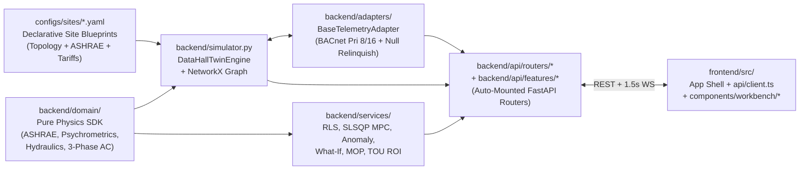

# Aether-DCTWIN Modular Architecture Guide

This document maps the **Pandita's Aether-DCTWIN** codebase so multiple engineers can develop backend algorithms, industrial adapters, and React/Three.js UI panels in parallel with **zero merge conflicts** and **zero hardcoded site assumptions**.

---

## 1. Layered Architecture Overview

---

## 2. Directory & Responsibility Map

### A. Declarative Site Topologies (`configs/sites/*.yaml`)
No row names (`"ROW-C"`), unit IDs (`"CRAC-2"`, `"CDU-1"`), rack counts (`32`), or utility prices (`\$0.115/kWh`) are hardcoded in Python or TypeScript.
- [default_hall.yaml](file:///Users/pb/dctwin/configs/sites/default_hall.yaml): Reference 32-rack hybrid AI hall (`4 Rows`, `4 CRACs`, `2 CDUs`, `4 PDUs`, `2 UPS`).
- [compact_edge_16rack.yaml](file:///Users/pb/dctwin/configs/sites/compact_edge_16rack.yaml): 16-rack edge AI hall (`2 Rows`, `2 CRACs`, `1 CDU`, `2 UPS`) validated on every CI run.
- Loaded by [config_loader.py](file:///Users/pb/dctwin/backend/config_loader.py) (`DCTWIN_SITE_CONFIG` env var overrides the active YAML blueprint).

### B. Pure Domain Physics SDK (`backend/domain/`)
Stateless, deterministic, unit-explicit functions with 100% `pytest` invariant coverage:
- [ashrae.py](file:///Users/pb/dctwin/backend/domain/ashrae.py): ASHRAE TC 9.9 `A1–A4` air and `W1–W4` liquid thermal envelopes & severity classifier.
- [psychrometrics.py](file:///Users/pb/dctwin/backend/domain/psychrometrics.py): Magnus-Tetens dew point, manifold condensation margin, chiller `COP`, and waterside economizer regime share.
- [hydraulics_airflow.py](file:///Users/pb/dctwin/backend/domain/hydraulics_airflow.py): VFD cubic affinity laws, liquid/air sensible $\Delta T$, thermal capacitance ride-through seconds, and strainer/filter fouling health.
- [electrical.py](file:///Users/pb/dctwin/backend/domain/electrical.py): `120°` 3-phase phasor neutral current, NEMA phase imbalance %, NEC 80% continuous spare kW, and First-Law `calc_pue()`.

### C. Hardware & BACnet Adapter Layer (`backend/adapters/`)
- [telemetry_adapter.py](file:///Users/pb/dctwin/backend/adapters/telemetry_adapter.py): Defines `BaseTelemetryAdapter` (`read_facility_points`, `write_setpoint`, `relinquish_setpoint`) and `SimulatedTwinAdapter` implementing ASHRAE 135 BACnet Priority Array slots `8` (Supervisory AI) and `16` (Local Fallback PID).

### D. Modular AI, Optimization & Control Services (`backend/services/`)
- [calibration_rls.py](file:///Users/pb/dctwin/backend/services/calibration_rls.py): Stateful `2×2` `numpy` Recursive Least Squares (`ZoneRLSFilterState`) covariance & Kalman gain estimator for online $R_{\text{th}}$, $C_{\text{th}}$, and heat-exchanger `UA` fouling drift.
- [mpc_solver.py](file:///Users/pb/dctwin/backend/services/mpc_solver.py): Real receding-horizon `scipy.optimize.minimize(..., method="SLSQP")` solver with hard Control Barrier Function (`CBF`) inequality constraints.
- [forecaster_anomaly.py](file:///Users/pb/dctwin/backend/services/forecaster_anomaly.py): State-space thermal forecaster + `IsolationForest` + $\Delta T$ residual root-cause engine (strictly facility-side remediations).
- [optimizer_whatif.py](file:///Users/pb/dctwin/backend/services/optimizer_whatif.py): Topology-generic cooling setpoint optimizer and deep-copied counterfactual *"What-If"* simulator.
- [mop_graphrag.py](file:///Users/pb/dctwin/backend/services/mop_graphrag.py): `NetworkX` blast-radius traversal & ASHRAE TC 9.9 Method of Procedure (`MOP`) generator.
- [energy_roi.py](file:///Users/pb/dctwin/backend/services/energy_roi.py): Config-driven 24h Utility TOU tariff, UPS BESS peak-shaving, thermal storage, and 5-year NPV/CapEx business case engine.
- [copilot_service.py](file:///Users/pb/dctwin/backend/services/copilot_service.py): Tool-calling LLM orchestration (`llm_agent.py` + deterministic physics fallback).

### E. Conflict-Free FastAPI Routers & Plugin Loader (`backend/api/`)
- [deps.py](file:///Users/pb/dctwin/backend/api/deps.py): `TwinRuntimeContainer` singleton managing `twin_engine`, `telemetry_adapter`, `ai_service`, `telemetry_store`, and `connector_manager`.
- [routers/](file:///Users/pb/dctwin/backend/api/routers): Core domain routers (`telemetry_controls.py`, `ml_control.py`, `energy_roi.py`, `replay_connectors.py`, `copilot_llm.py`).
- [plugin_loader.py](file:///Users/pb/dctwin/backend/api/plugin_loader.py) & `backend/api/features/`: **Zero-Merge-Conflict Extension Point**. Any `.py` file added to `backend/api/features/` that exports `router = APIRouter()` is automatically discovered and mounted by `main.py` at startup!

### F. Modular React + Three.js Frontend (`frontend/src/`)
- [api/client.ts](file:///Users/pb/dctwin/frontend/src/api/client.ts): Typed REST client functions.
- [App.tsx](file:///Users/pb/dctwin/frontend/src/App.tsx): Clean top-level layout shell, WebSocket lifecycle, 3D viewport wrapper, and tab switcher.
- `components/workbench/`: Focused right-drawer panels (`ControlsInspectorPanel.tsx`, `AIAnalyticsPanel.tsx`, `WhatIfPanel.tsx`, `AgentCopilotPanel.tsx`).
- [featureTabs.ts](file:///Users/pb/dctwin/frontend/src/components/workbench/featureTabs.ts) & `components/workbench/features/`: **Zero-Merge-Conflict UI Extension Point**. Any `.tsx` file placed in `components/workbench/features/` exporting `export const plugin: FeatureWorkbenchPlugin` automatically appears as a new Workbench tab in the UI!
