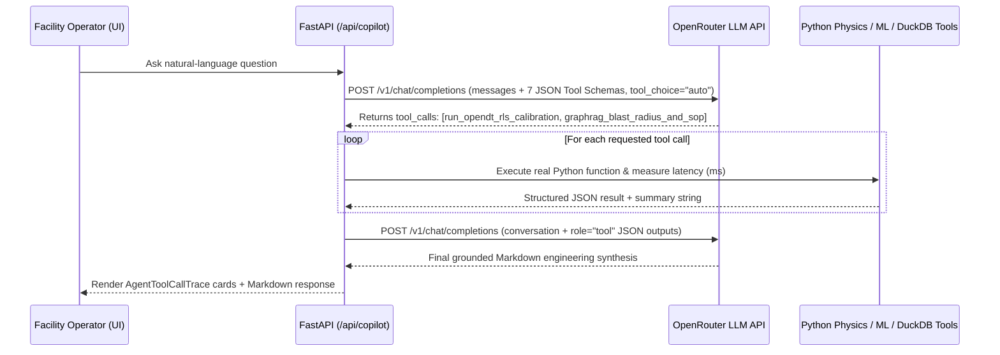

# Pandita's Aether-DCTWIN — Technical Documentation

**Architecture, Physics Formulations, Machine Learning Models, Data Schemas & API Reference**

---

## Table of Contents
1. [Architectural Philosophy: The Facility-First Boundary](#1-architectural-philosophy-the-facility-first-boundary)
2. [Facility Topology & NetworkX Multi-Layer Graph](#2-facility-topology--networkx-multi-layer-graph)
3. [Coupled Electro-Thermal & Hydraulic Physics Engine](#3-coupled-electro-thermal--hydraulic-physics-engine)
4. [Scientific Machine Learning & Control Algorithms](#4-scientific-machine-learning--control-algorithms)
   - [4.1 OpenDT Online Self-Calibration (RLS + Kalman Filter)](#41-opendt-online-self-calibration-rls--kalman-filter)
   - [4.2 State-Space PINN Thermal Forecaster](#42-state-space-pinn-thermal-forecaster)
   - [4.3 Multivariate Anomaly Detection (IsolationForest + Physics Residual)](#43-multivariate-anomaly-detection-isolationforest--physics-residual)
   - [4.4 Constrained Model Predictive Control (MPC) & Control Barrier Functions (CBF)](#44-constrained-model-predictive-control-mpc--control-barrier-functions-cbf)
   - [4.5 PUE Decomposition, Utility TOU Tariff, UPS BESS Peak-Shaving & Thermal Storage](#45-pue-decomposition-utility-tou-tariff-ups-bess-peak-shaving--thermal-storage)
5. [Autonomous OpenRouter LLM Tool-Calling & GraphRAG Architecture](#5-autonomous-openrouter-llm-tool-calling--graphrag-architecture)
6. [DuckDB + Parquet Time-Series Historian & BYOD Schema Auto-Mapper](#6-duckdb--parquet-time-series-historian--byod-schema-auto-mapper)
7. [3D WebGL Rendering & Dual-Theme Frontend Architecture](#7-3d-webgl-rendering--dual-theme-frontend-architecture)
8. [Complete REST & WebSocket API Reference](#8-complete-rest--websocket-api-reference)

---

## 1. Architectural Philosophy: The Facility-First Boundary

In production colocation and hyperscale AI factories, Critical Facilities teams own electrical distribution (`UPS → PDU → Rack Whip`) and mechanical heat rejection (`Cooling Tower → Chiller → CRAC / CDU → Cold Aisle / Manifold`), while tenant IT teams own the compute stack inside the server OS.

**Pandita's Aether-DCTWIN** is architected to treat IT compute power draw ($P_{\text{IT}}$) as an exogenous disturbance measured at the PDU/busway boundary, while providing full visibility down to the 42U rack chassis and Quick-Disconnect (`QD`) liquid manifold when Redfish/DCGM read-only feeds are enabled.

---

## 2. Facility Topology & NetworkX Multi-Layer Graph

Implemented in [`DataHallTwinEngine._init_topology`](file:///Users/pb/dctwin/backend/simulator.py#L64-L185), the facility is modeled as a directed multigraph $G = (V, E)$ in `NetworkX` with three edge layers (`power`, `air_cooling`, `liquid_cooling`):

### 2.1 Node Hierarchy
- **Uninterruptible Power Supplies (`UPS-A`, `UPS-B`)**: Rated at `1,600 kW` each (`N+1` redundant), `96.4%` double-conversion efficiency.
- **Row Power Distribution Units (`PDU-A` .. `PDU-D`)**:
  - `PDU-A` (`ROW-A`, `250 kW` rated, fed by `UPS-A`)
  - `PDU-B` (`ROW-B`, `250 kW` rated, fed by `UPS-A`)
  - `PDU-C` (`ROW-C`, `800 kW` rated, fed by `UPS-B`)
  - `PDU-D` (`ROW-D`, `800 kW` rated, fed by `UPS-B`)
- **Perimeter Computer Room Air Conditioners (`CRAC-1` .. `CRAC-4`)**:
  - `CRAC-1` (North-West) & `CRAC-2` (North-East) serve `ROW-A` and `ROW-B` (`280 kW` thermal capacity, `36,000 CFM` max VFD blower).
  - `CRAC-3` (South-West) & `CRAC-4` (South-East) serve the air-cooled fraction of `ROW-C` and `ROW-D`.
- **Direct-to-Chip Liquid Cooling Distribution Units (`CDU-1`, `CDU-2`)**:
  - `CDU-1` serves `ROW-C` (`850 kW` thermal capacity, `560 LPM` max secondary propylene-glycol/water loop).
  - `CDU-2` serves `ROW-D` (`750 kW` thermal capacity, `560 LPM` max flow).
- **32 Server Racks (`R-A01` .. `R-D08`, 4 Rows × 8 Racks)**:
  - `ROW-A`: Air-cooled General Compute (`18 kW` max/rack)
  - `ROW-B`: Air-cooled Cloud Storage + L40S Inference (`22 kW` max/rack, 4 GPUs/rack)
  - `ROW-C`: Hybrid Direct-to-Chip Liquid LLM Training (`85 kW` max/rack, `32x NVIDIA HGX B200` GPUs/rack)
  - `ROW-D`: Hybrid Direct-to-Chip Liquid AI Inference (`65 kW` max/rack, `24x NVIDIA HGX H200` GPUs/rack)

---

## 3. Coupled Electro-Thermal & Hydraulic Physics Engine

Every simulation step (`dt = 2.0s` in [`DataHallTwinEngine.step`](file:///Users/pb/dctwin/backend/simulator.py#L251-L558)) solves the coupled power, airflow, coolant flow, and thermal state equations:

### 3.1 Server Electrical Power & Cubic Fan Affinity Law
Each rack's compute power combines static idle leakage (`14%`) with dynamic utilization $u_i(t) \in [0, 100]$ and internal server fan power $P_{\text{fan}, i}$:

$$P_{\text{compute}, i} = P_{\text{max}, i} \cdot \left(0.14 + 0.82 \cdot \frac{u_i(t)}{100}\right)$$

$$P_{\text{fan}, i} = P_{\text{fan, max}} \cdot \left(\omega_{\text{fan}, i}\right)^3, \quad P_{\text{rack}, i} = P_{\text{compute}, i} + P_{\text{fan}, i}$$

Similarly, perimeter CRAC blower power and CDU secondary pump power follow the **Pump & Fan Affinity Laws**:

$$P_{\text{CRAC}, k} = P_{\text{standby}} + P_{\text{rated}} \cdot \left(\frac{\text{RPM}_k}{100}\right)^3, \quad P_{\text{CDU}, m} = P_{\text{standby}} + P_{\text{pump, rated}} \cdot \left(\frac{\text{Speed}_m}{100}\right)^{2.8}$$

### 3.2 Hybrid Direct-to-Chip Liquid vs. Air Heat Split
For hybrid liquid-cooled AI racks (`ROW-C` and `ROW-D`), cold plates mounted directly on the GPUs and CPUs capture fraction $\eta_{\text{DLC}}$ (`~76%` under nominal flow, degrading if `CDU` flow or fouling factor $\phi_m < 1.0$ drops):

$$Q_{\text{liquid}, i} = \eta_{\text{DLC}}(\dot{V}_m, \phi_m) \cdot P_{\text{rack}, i}, \quad Q_{\text{air}, i} = P_{\text{rack}, i} - Q_{\text{liquid}, i}$$

The per-rack coolant return temperature $T_{\text{return}, i}$ is governed by the mass-flow heat balance ($C_p \approx 3.95\text{ kJ/(kg}\cdot\text{K)} \Rightarrow 0.0658\text{ kW/(LPM}\cdot\text{K)}$):

$$T_{\text{return}, i} = T_{\text{supply}, m} + \frac{Q_{\text{liquid}, i}}{0.0658 \cdot \dot{V}_{\text{rack}, i}}$$

For air heat rejection across the rack (`CFM` airflow):

$$T_{\text{outlet}, i} = T_{\text{inlet}, i} + \frac{1755.0 \cdot Q_{\text{air}, i}}{\text{CFM}_i}$$

### 3.3 Cold-Aisle Spatial Distribution, Recirculation & Thermal Inertia
Cold-aisle inlet temperature $T_{\text{inlet}, i}$ is computed via inverse-distance airflow weighting from active zone CRAC units plus end-of-row recirculation $\Delta T_{\text{edge}}$, zone static-pressure deficit $\Delta T_{\text{deficit}}$, and first-order sensor/chassis thermal inertia ($\tau$):

$$T_{\text{inlet}, i}(t + \Delta t) = \alpha_{\text{air}} T_{\text{inlet}, i}(t) + (1 - \alpha_{\text{air}}) \left(\frac{\sum_k w_{ik} T_{\text{supply}, k}}{\sum_k w_{ik}} + \Delta T_{\text{edge}} + \Delta T_{\text{deficit}} + \Delta T_{\text{fault}, i}\right)$$

### 3.4 Central Chiller Plant COP & Facility PUE
Because direct-to-chip liquid cooling uses warm supply water (`23–27°C`), it leverages partial free-cooling / waterside economizers at a significantly higher Coefficient of Performance ($\text{COP}_{\text{liquid}} \approx 7.8–8.4$) than chilled-water air coils ($\text{COP}_{\text{air}} \approx 4.0–4.5$), both varying non-linearly with outdoor wet-bulb temperature $T_{\text{wb}}$:

$$\text{COP}_{\text{air}} = \max\left(2.2,\; 4.4 + 0.14(T_{\text{sp, air}} - 18.0) - 0.13(T_{\text{wb}} - 18.0)\right)$$

$$\text{COP}_{\text{liquid}} = \max\left(3.5,\; 8.2 + 0.22(T_{\text{sp, cdu}} - 24.0) - 0.16(T_{\text{wb}} - 18.0)\right)$$

$$\text{PUE} = \frac{P_{\text{IT}} + P_{\text{chiller, air}} + P_{\text{chiller, liq}} + \sum P_{\text{CRAC}} + \sum P_{\text{CDU}} + P_{\text{tower}} + P_{\text{PDU\_loss}} + P_{\text{UPS\_loss}}}{P_{\text{IT}}}$$

---

## 4. Scientific Machine Learning & Control Algorithms

### 4.1 OpenDT Online Self-Calibration (RLS + Kalman Filter)
Implemented in [`DataCenterAIService.compute_opendt_calibration`](file:///Users/pb/dctwin/backend/ai_engine.py#L905-L998).
Using only facility-side telemetry ($\Delta T_z = T_{\text{return}, z} - T_{\text{supply}, z}$ and zone thermal load $Q_z$), the estimator recursively updates each zone's effective **Thermal Resistance ($R_{\text{th}, z}$)** and **Thermal Capacitance ($C_{\text{th}, z}$)** with forgetting factor $\lambda = 0.985$:

$$C_{\text{th}, z} \frac{\text{d}T_z}{\text{d}t} + \frac{T_z - T_{\text{supply}, z}}{R_{\text{th}, z}} = Q_z(t)$$

When the learned $R_{\text{th}, z}$ rises above its nominal baseline $R_{\text{th}, z}^{\text{nom}}$, the model quantifies **Heat-Exchanger $U \cdot A$ Degradation (%)**:

$$\text{UA}_{\text{degradation}} = \left(1 - \frac{R_{\text{th}, z}^{\text{nom}}}{R_{\text{th}, z}^{\text{learned}}}\right) \times 100\%$$

- `UA_degradation < 6%`: `HEALTHY`
- `6% <= UA_degradation < 15%`: `EARLY_DRIFT` (early strainer/filter loading detected before any temperature threshold is breached)
- `UA_degradation >= 15%`: `MAINTENANCE_REQUIRED`

### 4.2 State-Space PINN Thermal Forecaster
Implemented in [`DataCenterAIService.update_forecasts_and_anomalies`](file:///Users/pb/dctwin/backend/ai_engine.py#L46-L246).
Generates multi-horizon facility and rack predictions at $H \in \{+1, +5, +10, +15, +30\}$ minutes with 95% epistemic uncertainty bands ($\pm \sigma_H$).

### 4.3 Multivariate Anomaly Detection (`IsolationForest` + Physics Residual)
Combines a 4-feature `scikit-learn` `IsolationForest` (`[inlet_temp_c, delta_t_air, chip_to_inlet_ratio, power_utilization_ratio]`) with an explicit physics $\Delta T$ residual check to eliminate false positives during normal high-load bursts while catching true recirculation and flow faults.

### 4.4 Constrained Model Predictive Control (MPC) & Control Barrier Functions (CBF)
Implemented in [`DataCenterAIService.compute_mpc_policy`](file:///Users/pb/dctwin/backend/ai_engine.py#L1000-L1072).
Solves a 6-step (`30-minute`) receding-horizon optimization problem minimizing weighted PUE, thermal risk, and VFD slew rate ($\Delta u_t$):

$$\min_{u_{0:N}} \sum_{k=0}^{N} \left[ w_1 \cdot \text{PUE}(x_k, u_k) + w_2 \cdot \psi_{\text{CBF}}(x_k) + w_3 \cdot \|u_k - u_{k-1}\|^2 \right]$$

Subject to three hard **Control Barrier Functions (CBFs)**:
1. **CBF-1 (ASHRAE A1 SLA)**: $h_1(x) = 27.0^\circ\text{C} - T_{\text{inlet, max}}(x) \ge 0$
2. **CBF-2 (Liquid Boiling / Cold-Plate SLA)**: $h_2(x) = 40.0^\circ\text{C} - T_{\text{cdu\_return, max}}(x) \ge 0$
3. **CBF-3 (Anti-Hunting VFD Slew Limit)**: $\|\Delta \text{RPM}_t\| \le 4.0\% / \text{min}$

### 4.5 PUE Decomposition, Utility TOU Tariff, UPS BESS Peak-Shaving & Thermal Storage
Implemented in [`DataCenterAIService.compute_energy_grid_management`](file:///Users/pb/dctwin/backend/ai_engine.py#L1239-L1358).
Co-optimizes electrical grid import ($P_{\text{grid}, t}$) across a 24-hour Time-of-Use (`TOU`) tariff schedule (`OFF_PEAK` @ `$0.068/kWh`, `SHOULDER` @ `$0.112–$0.115/kWh`, `CRITICAL_PEAK` @ `$0.185–$0.285/kWh`) using two facility-side storage buffers:

1. **UPS-A / UPS-B Li-Ion BESS Peak-Demand Shaving ($P_{\text{BESS}, t}$)**:
   - Discharges `115–165 kW` during `14:00–20:00` critical-peak windows (retaining `>85%` SOC reserve for N+1 backup) and recharges during `00:00–08:00` off-peak hours.
   - Reduces monthly utility peak-demand charges (`$22.50 / kW-month` shaved) and performs daily TOU price arbitrage.
2. **Chilled-Water Thermal Storage Pre-Cooling & Coasting ($P_{\text{thermal}, t}$)**:
   - Pre-chills the secondary liquid loop and concrete slab during shoulder hours (`12:00–14:00`, `+38 kW`) and coasts during critical peak hours (`14:00–20:00`, `-28.5 kW` chiller compressor reduction):

$$P_{\text{grid}, t}^{\text{opt}} = P_{\text{facility}, t}^{\text{base}} - \Delta P_{\text{PUE\_opt}, t} - P_{\text{BESS}, t} + P_{\text{thermal}, t}$$

---

## 5. Autonomous OpenRouter LLM Tool-Calling & GraphRAG Architecture

Implemented in [`backend/llm_agent.py`](file:///Users/pb/dctwin/backend/llm_agent.py).

### Callable Agent Tools (`AGENT_TOOLS_OPENAI_SCHEMA`)
1. `inspect_facility_telemetry`: Reads live PUE, kW, temperatures, IsolationForest anomalies, and 30m forecasts.
2. `run_opendt_rls_calibration`: Runs the RLS/Kalman parameter estimator and returns zone $R_{\text{th}}$, RMSE, and fouling drift.
3. `solve_constrained_mpc_lookahead`: Solves the 30m CBF-constrained MPC trajectory.
4. `graphrag_blast_radius_and_sop`: Traverses the `NetworkX` graph from any asset (`CDU-1`, `CRAC-2`, `PDU-C`) and synthesizes a 5-phase MOP checklist.
5. `run_counterfactual_whatif`: Deep-copies the live twin and simulates load/cooling modifications.
6. `query_duckdb_24h_history`: Executes analytical SQL over the 24-hour DuckDB/Parquet tables.
7. `execute_cooling_setpoints`: Applies optimal CRAC/CDU setpoints and enables closed-loop AI Auto-Pilot.

---

## 6. DuckDB + Parquet Time-Series Historian & BYOD Schema Auto-Mapper

Implemented in [`backend/telemetry_store.py`](file:///Users/pb/dctwin/backend/telemetry_store.py) and [`backend/connectors.py`](file:///Users/pb/dctwin/backend/connectors.py).

- **Table Schema (`telemetry_24h`)**: Stores `288 × 5-minute` intervals per dataset (`kaggle_green_ai_24h`, `ornl_frontier_cdu_24h`, `ieee_ashrae_fault_24h`, plus any customer `byod_*` dataset) and exports each dataset directly to `data/<dataset_id>.parquet`.
- **Fuzzy Column Matching (`CANONICAL_FIELD_ALIASES`)**: Maps arbitrary vendor CSV column headers (e.g., `Schneider_IT_Load_kW`, `dcgm_fi_dev_gpu_temp`, `ashrae_max_inlet_c`) to canonical physics fields, normalizes `Watts → kW`, computes missing PUE/cooling balances, writes a new Parquet file, and synchronizes the 3D twin to the customer's peak thermal interval.

---

## 7. 3D WebGL Rendering & Dual-Theme Frontend Architecture

Implemented in [`frontend/src/components/DataHall3D.tsx`](file:///Users/pb/dctwin/frontend/src/components/DataHall3D.tsx) using `@react-three/fiber` and `@react-three/drei`:
- **32 Interactive Rack Meshes**: Dynamic front thermal LED strips, vertical power pillars, direct-to-chip liquid manifold caps, and floating HTML telemetry pills.
- **CFD Thermal Plumes (`RackAirflowPlume`)**: Animated translucent exhaust cones and 3-stage streamline spheres rising from cold aisle to hot aisle.
- **Liquid Coolant Pulses (`LiquidCoolantFlowPulses`)**: Animated spheres traveling along the overhead `ROW-C` and `ROW-D` headers.
- **Dual Theme (`Dark` / `Light Mode`)**: Controlled via `html.light-theme` in [`index.css`](file:///Users/pb/dctwin/frontend/src/index.css) and passed into the Three.js scene lighting/fog/grid props.

---

## 8. Complete REST & WebSocket API Reference

| Method & Route | Request Body / Params | Description |
| :--- | :--- | :--- |
| `GET /api/state` | — | Full `TwinStateSnapshot` (32 racks, 4 CRACs, 2 CDUs, 4 PDUs, 2 UPS, anomalies, forecasts, optimization). |
| `WS /ws/telemetry` | WebSocket | Streams `TwinStateSnapshot` JSON every `1.5 seconds`. |
| `POST /api/scenario` | `{"scenario_id": "..."}` | Trigger `normal`, `gpu_burst_row_c`, `crac_2_fail`, `cdu_1_fouling`, `hot_aisle_recirc`, or `heatwave`. |
| `POST /api/controls` | `ControlSetpointRequest` | Update CRAC/CDU setpoints, fan/pump speeds, or toggle `auto_optimize`. |
| `POST /api/apply-optimization` | — | Immediately apply all recommended optimizer actions and enable AI Auto-Pilot. |
| `GET /api/rack/{rack_id}/elevation` | Path: `rack_id` | Returns `RackElevationResponse` with all 42U server blades, per-die GPU temps, and manifold telemetry. |
| `POST /api/rack/blade-action` | `BladeActionRequest` | Inject or clear 42U blade faults (`inject_qd_restriction`, `inject_workload_spike`, `cap_power_80`, `clear_fault`). |
| `GET /api/opendt/calibration` | — | Returns `OpenDTCalibrationReport` (RLS/Kalman RMSE convergence, learned $R_{\text{th}}$, $C_{\text{th}}$, and UA fouling drift). |
| `GET /api/mpc/policy` | — | Returns `MPCPolicyState` (30-min lookahead trajectory, CBF safety barriers, anti-hunting savings). |
| `POST /api/graphrag/mop` | `MOPGenerationRequest` | Traverses `NetworkX` blast radius and generates a 5-phase `MOPDocumentResponse`. |
| `GET /api/energy/grid` | — | Returns `EnergyGridManagementState` (5-way PUE power breakdown, 24h TOU tariff schedule, BESS peak-shaving kW, and annual OpEx savings). |
| `POST /api/energy/dispatch` | `EnergyDispatchRequest` | Toggle UPS Li-Ion BESS peak-shaving, chilled-water thermal pre-cooling, and utility Critical-Peak Demand Response (`DR`) events. |
| `POST /api/what-if` | `WhatIfRequest` | Clones the live twin and runs a counterfactual simulation (`WhatIfResponse`). |
| `POST /api/copilot` | `AgentQueryRequest` | Executes the live OpenRouter/OpenAI tool-calling agent (or local multi-tool fallback). |
| `GET / POST /api/llm/config` | `LLMProviderConfigRequest` | Get or update the active OpenRouter/OpenAI API key and model ID. |
| `GET /api/datasets` | — | List all 24h DuckDB/Parquet datasets (`DatasetInfo[]`). |
| `GET /api/replay/{dataset_id}` | Path: `dataset_id` | Return all 288 5-minute intervals for the 24h timeline scrubber. |
| `POST /api/replay/seek` | `ReplaySeekRequest` | Synchronize the live 32-rack 3D Digital Twin to a historical 5-minute step. |
| `GET /api/connectors` | — | List industrial protocol connectors (`BACnet/Modbus`, `NVIDIA DCGM`, `Redfish`, `MQTT`). |
| `POST /api/connectors/test` | `ConnectorTestRequest` | Poll a live protocol frame and calibrate the twin. |
| `GET /api/connectors/sample-csv/{vendor}` | `schneider_bms`, `nvidia_dcgm`, `sunbird_dcim` | Download a realistic 24h vendor CSV file for BYOD testing. |
| `POST /api/connectors/ingest-byod` | `BYODIngestRequest` | Auto-map customer CSV columns, save to DuckDB/Parquet, and calibrate the 3D twin. |
| `GET /api/roi-report` | — | Generate the `ExecutiveROIReport` (PUE, OpEx `$`, MWh, tCO₂, unlocked GPUs, 5-year NPV, Markdown export). |
